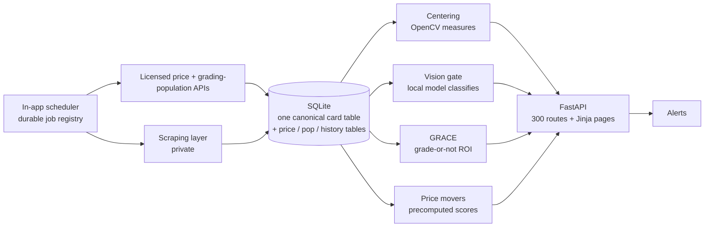

# Collectors — case study (private repo)

**One line:** a local-first FastAPI + SQLite app I built to make trading-card buy, grade and sell decisions from data instead of gut feel. Private; walkthrough on request.

| At a glance | |
|---|---|
| Stack | Python 3.12, FastAPI, SQLite, Jinja, OpenCV, a local vision model |
| Built | Apr 23 – Jul 13, 2026: 226 commits on the main working branch (389 across all branches) |
| Size | 300 HTTP routes, 320 Python modules |
| Database | schema version 56; migrations are safe to re-run |
| Tests | 396 test files, 7,013 test functions |
| CI | 379 of the 396 test files on PRs and pushes, 80% branch-coverage floor |

---

## 1. The problem

Buying cards to grade and resell is a pile of small bets. Each one turns on questions a person answers badly by eye:

- Is this raw card centered well enough to grade a 10?
- After grading fees, is it worth grading at all?
- Which prices are actually moving, and which are noise?
- Is the photo even a raw card, or a card that is already graded?

I wanted one place that answers those with numbers, keeps its own history, and runs on my own machine.

## 2. What I built

The main pieces:

- **Centering measurement.** OpenCV finds the card's borders and measures left/right and top/bottom centering, with the evidence saved (edge maps, overlays, pixel widths, a confidence score). Code measures; no model is allowed to invent a measurement.
- **Vision gate.** A small local vision model sorts each photo first: raw bordered card, full-art card, already-graded slab, group shot, or unusable. Only usable raw cards go on to be measured.
- **GRACE.** Should this card be graded? It ranks cards by expected value per dollar after fees and turnaround.
- **Price movers.** A daily job scores which cards are rising or falling over several windows and stores the results, so the page reads an indexed table instead of scanning history on every request.
- **Scheduler.** Jobs live in a database table with their next run time, so a restart never loses or double-runs a job. A job missed while the app was down runs once on the next start, not once per missed day.
- **One canonical card table.** Every price, population count and image hangs off one card ID, with foreign keys enforced. Before this, each page kept its own copy of prices and they drifted apart.

Most of it was built with AI coding agents (185 of the 226 commits carry an AI co-author line), working under rules I set: read the file's doc before editing it, and write tests with the change. CI runs on every PR and on pushes to main, dev and feature branches, and the last commit's run is green. I didn't always wait for it: one batch of 8 PRs went in red on May 26, and most work landed by direct push (16 of 186 commits on the main line are merges).

The agents were also fenced in by checks in code, not just by rules:

- a test fails the build if any code opens the database without the safe wrapper;
- the test suite points at a throwaway database and refuses any write-capable connection to the production file;
- CI fails if a test run changes any tracked file.

## 3. How I know it works

**Tests and CI.** 396 test files; the 394 in the main test folder hold 7,013 test functions. CI runs 379 of the files in parallel on PRs and on pushes to the main and feature branches. The 15 slow OpenCV centering test files are opt-in (RUN_OPENCV_TESTS=1), and live browser/network tests are off by default. CI fails if branch coverage drops below 80%, if whitespace is broken, or if the test run changes any tracked file.

**Tests that lock in incident fixes.** When a file-handle leak once stopped the daily jobs, the fix came with a test that fails the build if any code opens the database without the safe wrapper. A schema test checks that table rebuilds happen inside one transaction. It is built to fail deterministically if a rebuild leaves its transaction; with the fix reverted, the race came back in 2 of 5 runs.

**Honest CI record.** Of the last 200 CI runs, 121 passed, 54 failed and 25 were cancelled. A red run is CI doing its job, but some of the failures were timing-flaky tests under parallel runs, not real bugs. I fixed the ones I could find and let CI retry only tests that failed, up to 3 times. A truly broken test still fails every retry.

**Evals for the model parts.** I measured both judgment layers against labeled data before trusting them:

- *Vision model bake-off.* 4 local vision models tried (3 finished), 20 hand-labeled photos. The pick caught every slab and group shot in the set and named the card type right 80% of the time, at a median of 14.5 s per photo. It missed full-art cards (caught 1 of 5). A more aggressive prompt raised that to 4 of 5 but let both test slabs through (a small set: 2 slabs), so I **rejected the prompt change**. Instead I added a geometry check in code that catches the full-art mistake without needing the model to get better.
- *Centering self-test.* I measured photos of cards already graded PSA 10, so the correct answer is known: every one should pass the centering limit. Of 60 measured, 41 (68.3%) read worse than the old 60/40 limit. That means the pipeline, not the cards, was failing on real listing photos. So centering results pass through geometry guards in code before any alert, and I review alerts myself. Small sample (n = 60), so I trust the direction more than the exact rate.

I'm proudest of that second result. It caught the pattern behind false alerts, so I added code guards instead of trusting the measurement.

## 4. What I'd do differently

1. **Build the eval set first.** The centering self-test came after the pipeline. A labeled set from day one would have shown the photo problem weeks earlier.
2. **APIs before scraping.** I first collected some prices through the scraping layer, then moved them to a licensed API. The API was cheaper and more reliable. I'd start there and keep scraping for one-time gaps.
3. **A smaller core.** One app with 300 routes holds too many jobs at once: data collection, vision, pricing, alerts. I'd split it into a small core plus separate packages, each with its own tests.
4. **Design tests to run in parallel from the start.** Per-worker databases and isolated temp files came late. Until then, parallel runs failed at random.
5. **Keep the slow tests in CI.** The centering tests are opt-in to keep the suite fast. I'd keep them in CI, even as a slower nightly job.
6. **Fewer docs, kept current.** Agents wrote a doc for every file. That helped them find their way around, but it was more to keep current than one short architecture page plus good tests.

## 5. What's private, and why

- **Data.** Prices come from paid, licensed feeds I haven't cleared for republishing, and the history includes my own private records.
- **The scraping layer.** It depends on other sites' terms, so it stays private.
- **An auto-buy prototype**, kept private.
- **Running it.** The app expects the private environment and data. CI runs its default test suite (379 files) on a clean machine.

A curated public copy is planned: centering, GRACE, price movers, the app shell, their tests and CI, with the data sources and scraping layer removed. Until then I'm happy to give a live walkthrough of the code, tests and CI history.

## Same methods, public code

| Method used in Collectors | Public repo |
|---|---|
| Grade-or-not ROI, data-quality gates | [grace-grading-roi](https://github.com/chasebak/grace-grading-roi) |
| Validation, leakage checks, small-n honesty | [cardsegments](https://github.com/chasebak/cardsegments) |
| Pricing and restock decisions from noisy demand | [milo](https://github.com/chasebak/milo) |
| Estimating from partial data, checked against a simulator | [ordergaps](https://github.com/chasebak/ordergaps) |
| Code owns the steps, models judge, humans approve | cardshop-agents (in progress; link added when it's public) |

All public repos run on synthetic data.

[← Back to profile](README.md)
